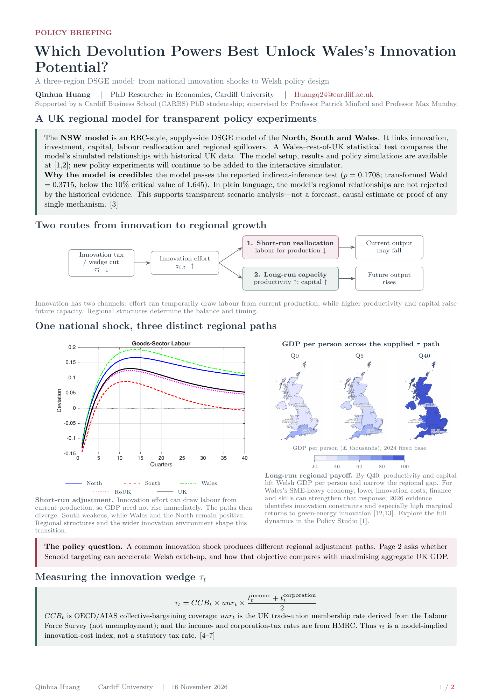
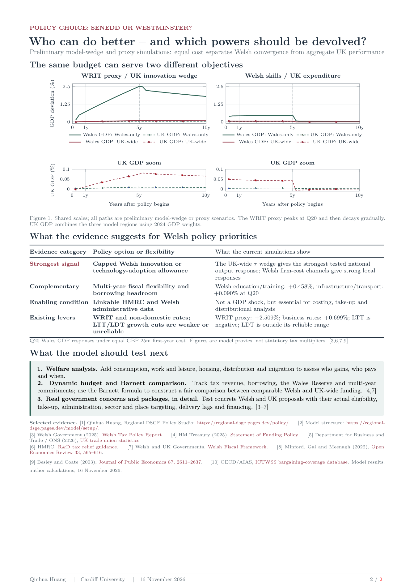

# Regional Policy Simulations

*Policy research on innovation, fiscal devolution and regional economic adjustment in the United Kingdom.*

This page presents an exploratory two-page policy briefing alongside an interactive policy studio. The analysis uses a three-region DSGE model distinguishing **North, South and Wales**. The results are **model-conditional scenarios**, not official forecasts or causal estimates of implemented policies.

## Featured policy briefing

### Which Devolution Powers Best Unlock Wales’s Innovation Potential?

**Qinhua Huang · Cardiff University · 16 November 2026**

The two-page briefing examines how a common innovation-cost shock can produce different regional responses, and how Wales-only policy proxies compare with UK-wide interventions under a specified first-year fiscal-cost assumption. It distinguishes the objective of **Welsh convergence** from **aggregate UK output**.

[**Download the complete two-page policy briefing (PDF)**](../assets/policy/wales_innovation_policy_brief.pdf)

<figure class="policy-brief-page">
  
  <figcaption><strong>Page 1.</strong> Innovation transmission, regional adjustment and the model's innovation-cost wedge.</figcaption>
</figure>

<figure class="policy-brief-page">
  
  <figcaption><strong>Page 2.</strong> Wales-only versus UK-wide policy comparisons, preliminary evidence and research priorities.</figcaption>
</figure>

## Interactive Policy Studio

Explore simulated policy transmission across North, South and Wales, including the timing of responses over 40 quarters.

<a href="studio.html" target="_blank" rel="noopener noreferrer" style="display:inline-block;padding:12px 22px;background:#315d9f;color:white;text-decoration:none;border-radius:8px;font-weight:600;">Open Interactive Policy Studio ↗</a>

<iframe src="studio.html" title="HQ Regional DSGE Policy Studio" width="100%" height="980" style="border:1px solid #ddd;border-radius:8px" loading="lazy"></iframe>

## Interpretation and research status

The briefing reports **preliminary model-wedge and proxy simulations**. The innovation-cost wedge is a constructed model index, **not a statutory tax rate**. Comparisons depend on shock design, financing, regional aggregation and fiscal calibration. In particular, the reported £25 million comparison refers to an equal **first-year** fiscal cost, not necessarily equal present-value or lifetime costs.

The interactive studio contains imported Dynare responses for the tau experiment, with a manually sign-reversed display option still requiring verification. Other displayed policy scenarios should not be interpreted as validated simulation results where they are not yet populated. The scenario label “10% cut” has not been established as an exact 10% relative tax reduction; benchmark GDP-per-capita figures use supplied 2024 values, and other indices are illustrative.

These materials are **working research for discussion**, not an official Welsh Government forecast, a causal estimate or sufficient standalone evidence for a particular policy decision. Further indirect-inference validation, welfare analysis and consistent multi-year fiscal costing remain necessary.
