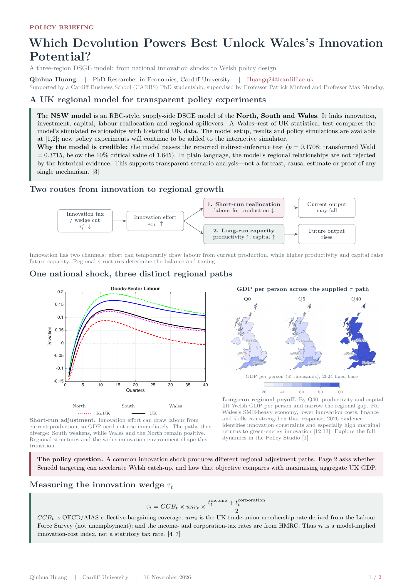
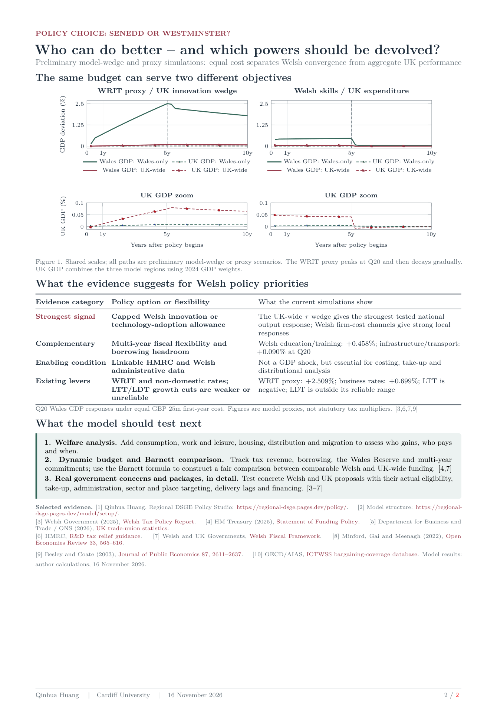

## Featured policy briefing
*Policy research on innovation, fiscal devolution and regional economic adjustment in the United Kingdom.*

This page presents an exploratory two-page policy briefing alongside an interactive policy studio. The analysis uses a three-region DSGE model distinguishing **North, South and Wales**. The results are **model-conditional scenarios**, not official forecasts or causal estimates of implemented policies.

### Which Devolution Powers Best Unlock Wales’s Innovation Potential?

**Qinhua Huang · Cardiff University · 16 November 2026**

The two-page briefing examines how a common innovation-cost shock can produce different regional responses, and how Wales-only policy proxies compare with UK-wide interventions under a specified first-year fiscal-cost assumption. It distinguishes the objective of **Welsh convergence** from **aggregate UK output**.

[**Download the complete two-page policy briefing (PDF)**](../assets/policy/wales_innovation_policy_brief.pdf)

<figure class="policy-brief-page">
  
  <figcaption><strong>Page 1.</strong> Innovation transmission, regional adjustment and the model's innovation-cost wedge.</figcaption>
</figure>

<figure class="policy-brief-page">
  
  <figcaption><strong>Page 2.</strong> Wales-only versus UK-wide policy comparisons, preliminary evidence and research priorities.</figcaption>
</figure>
