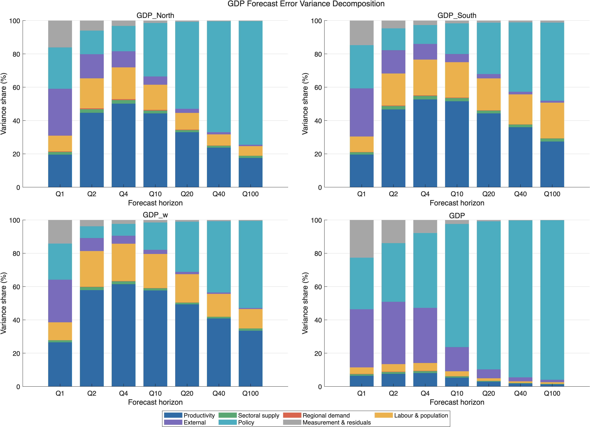
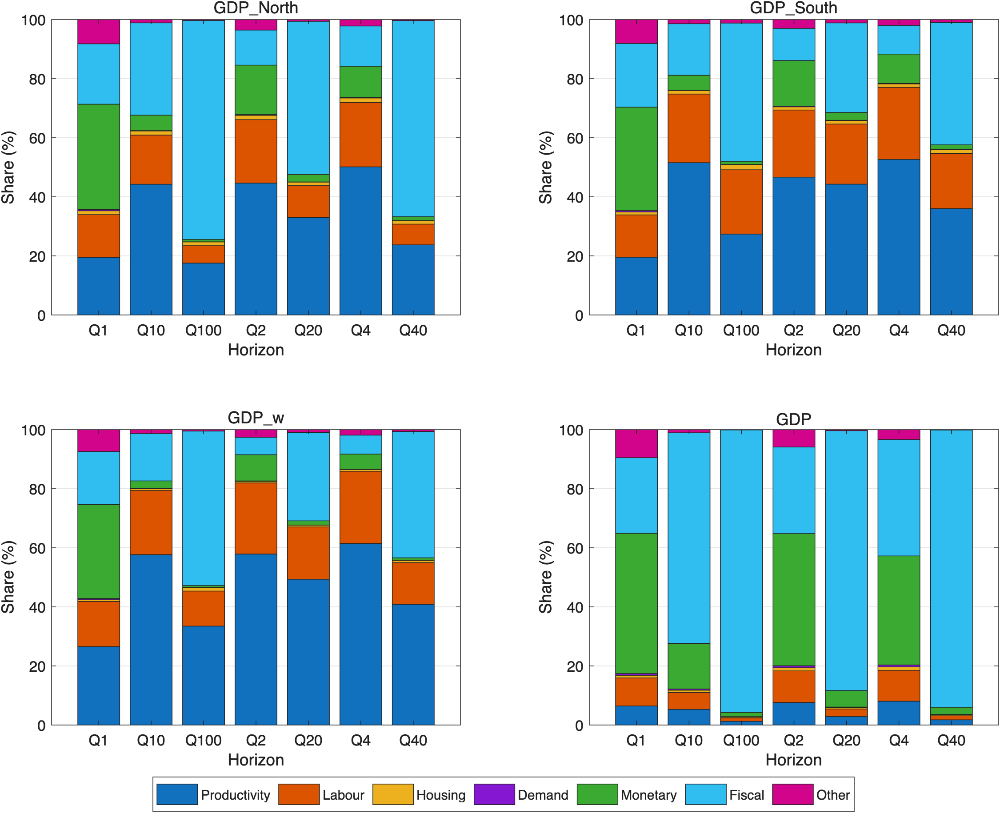
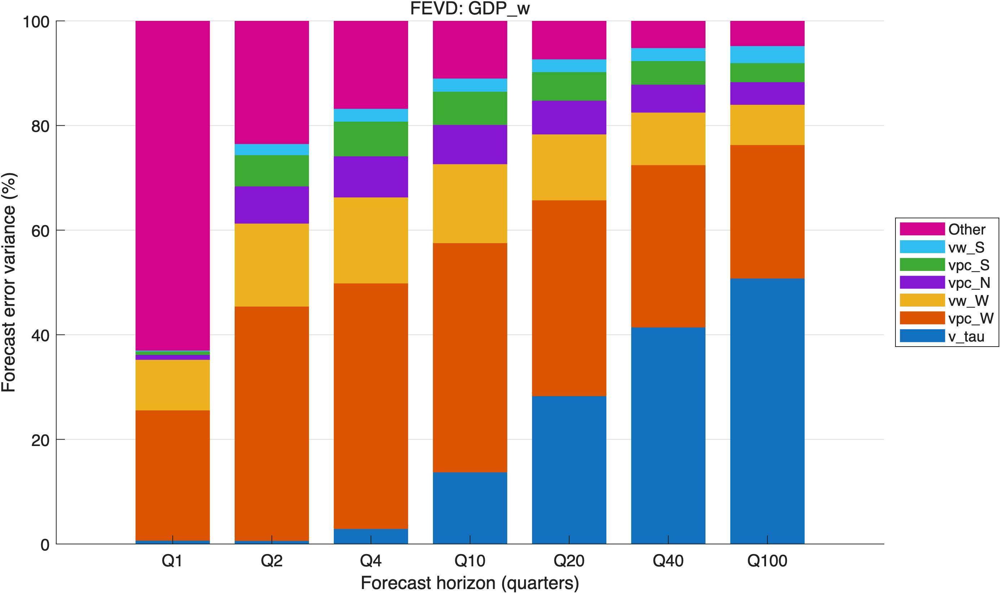
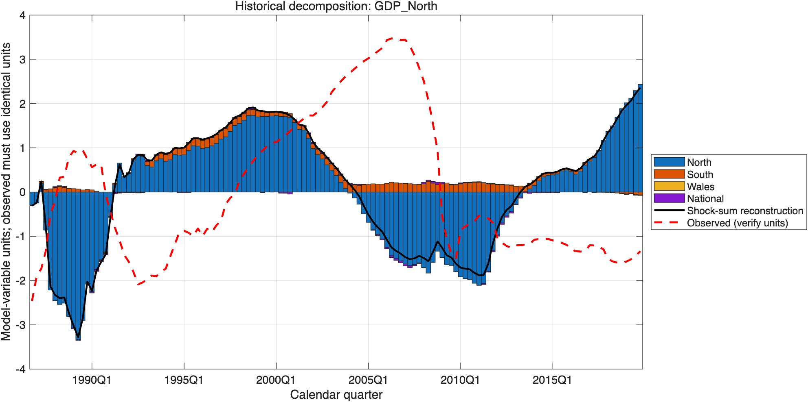
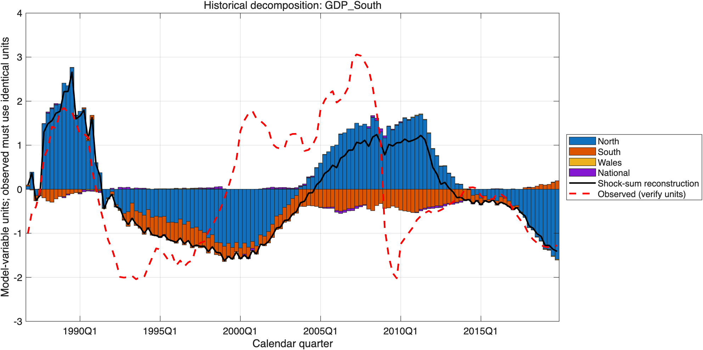
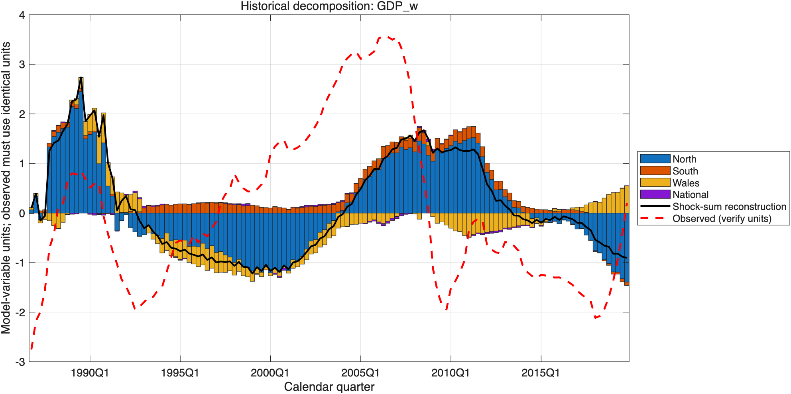

# Forecast Error Variance and Historical Decomposition

A forecast error variance decomposition (FEVD) allocates forecast-error variance across model shocks at a chosen forecast horizon. Historical decomposition attributes realised model fluctuations to shock sequences, subject to the model's measurement, filtering and decomposition conventions.

## Regional GDP: grouped shock mechanisms

## Wales: seven-category FEVD

Download the original FEVD values: [Wales](../assets/results/fevd_wales.csv), [North](../assets/results/fevd_north.csv), [South](../assets/results/fevd_south.csv), and [UK](../assets/results/fevd_uk.csv). The seven displayed categories are not necessarily seven primitive structural shocks; the remainder is grouped as "Other".

## Historical GDP decomposition

[Download historical-group data](../assets/results/historical_groups.csv) and [shock-mechanism mapping](../assets/results/shock_map.csv).

## Model fit diagnostic

The supplied `GDP_Fit_Diagnostics.csv` reports the following, with the original scales and transformation conventions **not yet independently verified**:

| Series | N | RMSE | Correlation | R² |
|---|---:|---:|---:|---:|
| North GDP | 133 | 2.383 | −0.242 | −1.095 |
| South GDP | 133 | 1.343 | 0.414 | 0.047 |
| Wales GDP | 133 | 1.767 | 0.165 | −0.165 |
| UK GDP | 133 | 1.541 | −0.381 | −0.202 |

The negative R² values and weak/negative correlations indicate that some reported historical reconstruction benchmarks fit poorly. This is a substantive diagnostic, not evidence of a validated historical fit. Check definitions, scaling, trend handling, alignment and whether exact accounting or fitted predictions underpin each plot before making strong claims.

[Download original GDP fit diagnostics](../assets/results/fit_diagnostics.csv).
