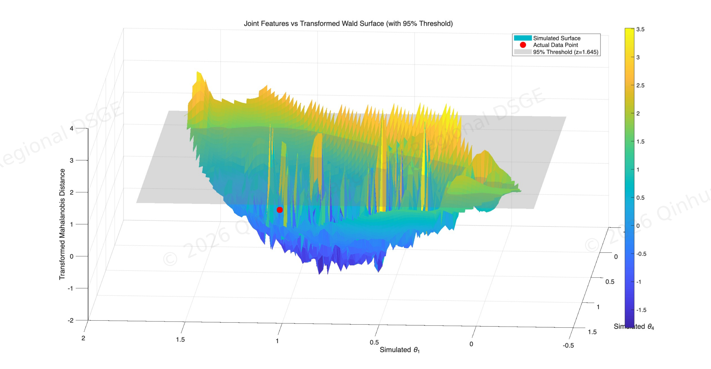
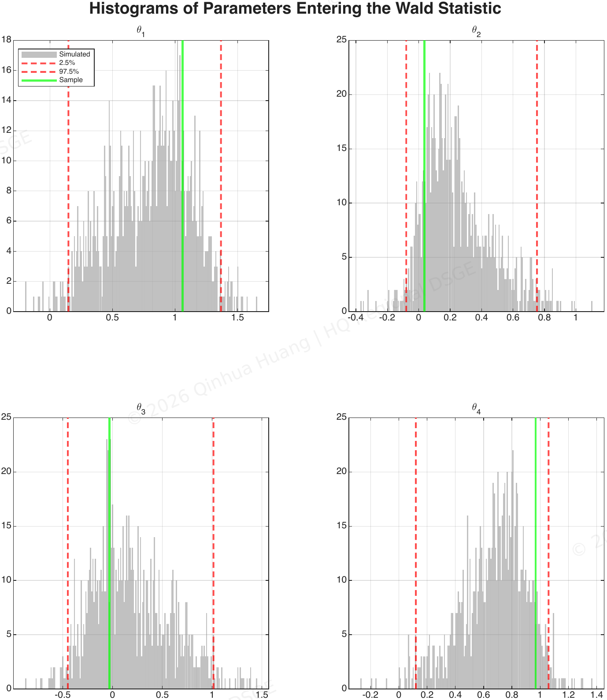

# Indirect Inference Estimation

*Empirical evaluation of the North–South–Wales DSGE model*

---

## Overview

Indirect Inference (II) estimates structural parameters
by comparing empirical auxiliary-model statistics with
their simulated counterparts generated by the DSGE model.

This approach evaluates the ability of the structural
model to reproduce key statistical features of observed
regional economic data.

## Estimation Framework

The II estimator minimises a weighted discrepancy
between observed and simulated auxiliary statistics.

Define the discrepancy vector as:

$$
d(\theta)
=
\widehat{\beta}_{data}
-
\overline{\beta}_{sim}(\theta)
$$

The indirect inference estimator is:

$$
\widehat{\theta}_{II}
=
\arg\min_{\theta}
d(\theta)^{T} W d(\theta)
$$

Here:

- **Theta:** the vector of structural DSGE parameters.
- **Beta:** coefficients of the auxiliary econometric model.
- **W:** the weighting matrix.
- **d:** the discrepancy between observed and simulated auxiliary statistics.

## Joint Wald Statistic Surface

*Figure 1. Three-dimensional simulated transformed Wald-distance surface. The red marker identifies the observed-data point, while the grey plane indicates the reference threshold shown in the original output.*

The surface illustrates how the transformed discrepancy
measure varies across parameter configurations.

The threshold shown is a visual reference and requires
verification against the specific test transformation
and calibration.

[View high-resolution PDF](../assets/ii_estimation_original.pdf)

---

## Simulated Parameter Distributions

*Figure 2. Simulated distributions of four coefficients entering the Wald statistic. Green lines indicate observed sample values; red dashed lines indicate the empirical 2.5th and 97.5th percentiles.*

The histograms illustrate the position of observed
auxiliary coefficients relative to their simulated
distributions.

These distributions provide useful diagnostics for
assessing the model's ability to reproduce empirical
auxiliary-model features.

[View high-resolution PDF](../assets/ii_histograms.pdf)

---

## Further Empirical Evaluation

Indirect Inference estimation is complemented by
formal model specification tests and Monte Carlo
power experiments.

These exercises evaluate both the empirical
compatibility of the DSGE model and the ability
of the specification test to detect departures
from the maintained structural model.

[II Specification Tests](ii-tests.md)

[Monte Carlo Power Analysis](power.md)

---

*Research status: Working paper. Results remain
subject to further robustness checks and validation.*
