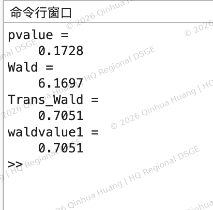

# Indirect Inference Specification Tests

## 1. Overview

The empirical validity of the three-region
North–South–Wales (NSW) DSGE model is evaluated
using Indirect Inference (II) specification tests.

The II procedure assesses whether the DSGE model
can reproduce key statistical features of the
observed UK regional GDP data.

Two alternative configurations of regional GDP
are considered to evaluate the robustness of
the model specification.

## 2. GDP Configurations

### Test A: Three-Region GDP

The first configuration uses three regional
GDP series:

- GDP of Northern England
- GDP of Southern England
- GDP of Wales

This configuration preserves the full
three-region structure of the DSGE model
and allows regional economic dynamics
to be assessed jointly.

### Test B: Wales versus the Rest of the UK

The second configuration uses two GDP series:

- GDP of Wales
- GDP of the Rest of the United Kingdom (RoUK)

This configuration focuses on the economic
relationship between Wales and the rest
of the UK.

It provides an alternative aggregation of
regional output for assessing the model's
empirical performance.

## 3. Indirect Inference Methodology

Indirect Inference compares auxiliary-model
statistics estimated from observed data
with the corresponding statistics generated
by simulated DSGE data.

The discrepancy is evaluated using a
Wald-type statistic.

Under the null hypothesis, the DSGE model
is capable of reproducing the selected
auxiliary statistics of the observed data.

A failure to reject the null hypothesis
indicates that the test has not identified
statistically significant discrepancies
between the model and the data.

However, non-rejection does not establish
that the model is correctly specified.

## 4. Specification Test Results

The following results are reported in the
supplied II test output.

| Statistic | Value |
|---|---:|
| Wald statistic | 6.1697 |
| Transformed Wald statistic | 0.7051 |
| Reported p-value | 0.1728 |

At the 5% significance level, the reported
test does not reject the maintained DSGE
specification.

The reported values relate to the supplied
test output and should not be assumed to
apply identically to both GDP configurations.

### Original MATLAB Output

## 5. Statistical Power of the II Test

Non-rejection is more informative when the
specification test has sufficient statistical
power against economically relevant
alternative models.

Monte Carlo power experiments therefore
complement the specification tests.

The power analysis investigates the rejection
frequency of the II procedure when structural
parameters are perturbed away from their
baseline values.

The reported experiments also assess the
finite-sample behaviour of the test.

The supplied power output reports an empirical
null rejection frequency of 7.6%, compared
with a nominal significance level of 5%.

This size discrepancy should be taken into
account when interpreting the power curves.

[Explore Monte Carlo Power Analysis](power.md)

## 6. Interpretation

The two GDP configurations provide complementary
approaches to evaluating the regional DSGE model.

The three-region configuration retains
the regional disaggregation of the model,
whereas the Wales–RoUK configuration
focuses on aggregate differences between
Wales and the rest of the UK.

Specification test results must be interpreted
jointly with the power analysis, since failure
to reject a model with low statistical power
provides limited evidence about its adequacy.

Together, these exercises contribute to
the empirical evaluation of regional DSGE
models using Indirect Inference.

---

**Research status:** Working research.
Test statistics and power results are subject
to verification against their corresponding
auxiliary specifications and simulation designs.
