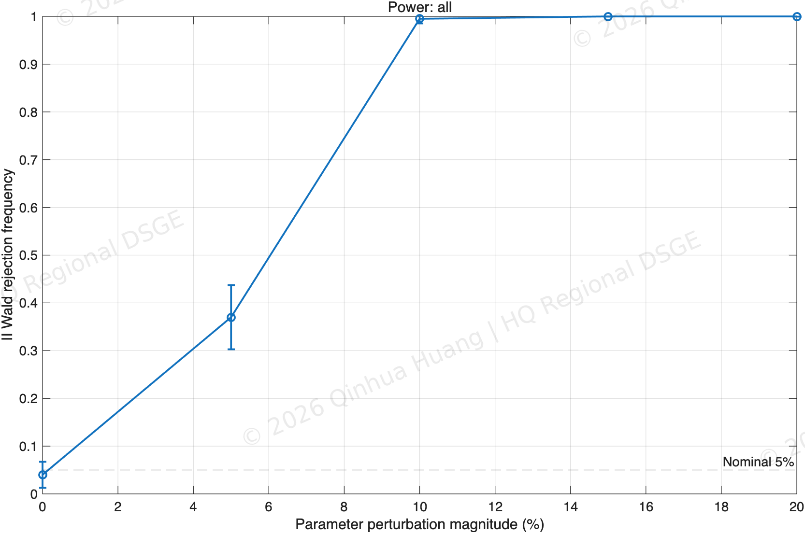

# Monte Carlo Power Analysis

Power measures the probability that a specification test rejects a false null. Perturbing structural parameters systematically allows the researcher to assess how sensitive the II Wald test is to alternatives.

[Open the original power-analysis figure](../assets/power_analysis.pdf).

The original power PDF explicitly labels **empirical size = 7.6%**, compared with **5% nominal size**. This suggests finite-sample over-rejection under the null in this reported run. The figure must not be described as a size-correct 5% test without additional evidence.

For a defensible comparison across parameter groups, hold fixed the Monte Carlo design and clearly document the null DGP, auxiliary model, replications, perturbation rule and critical-value calibration. Where the test size differs across designs, report size-adjusted power as well as raw rejection frequencies.

**Validation checkpoint:** Compare these plots against the exact auxiliary specification and latest simulation output before claiming that one group is more identifiable than another.
