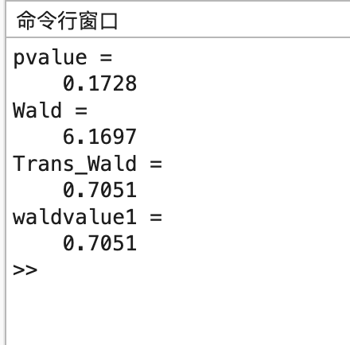

# Indirect Inference Specification Test

The II Wald test compares empirical auxiliary statistics with their simulated distribution under the maintained DSGE specification. Results depend on the chosen auxiliary model, simulation length, Monte Carlo design and finite-sample calibration.

## Supplied test output

| Statistic | Reported value |
|---|---:|
| Wald statistic | 6.1697 |
| Transformed Wald statistic | 0.7051 |
| Reported p-value | 0.1728 |

At a conventional 5% significance level, **the reported p-value does not reject the tested model specification**. This should not be described as accepting or proving the model. The interpretation is provisional until the auxiliary specification and bootstrap/simulation design are verified.

## Parameter diagnostics

[Open the parameter-statistic histograms](../assets/results/ii_histograms.pdf).

**Important:** The screenshot is one test run; do not infer that the same p-value applies to all auxiliary specifications or model versions.
